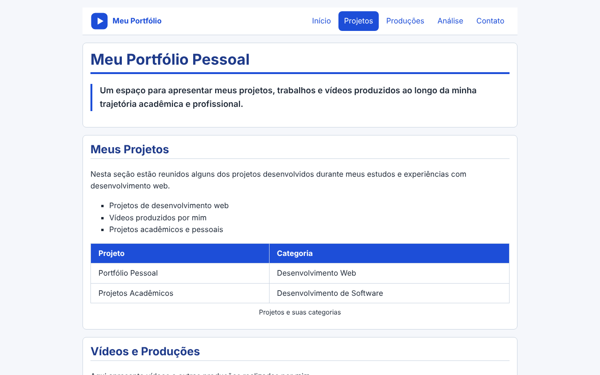
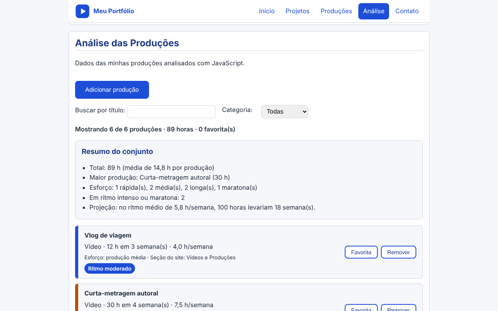
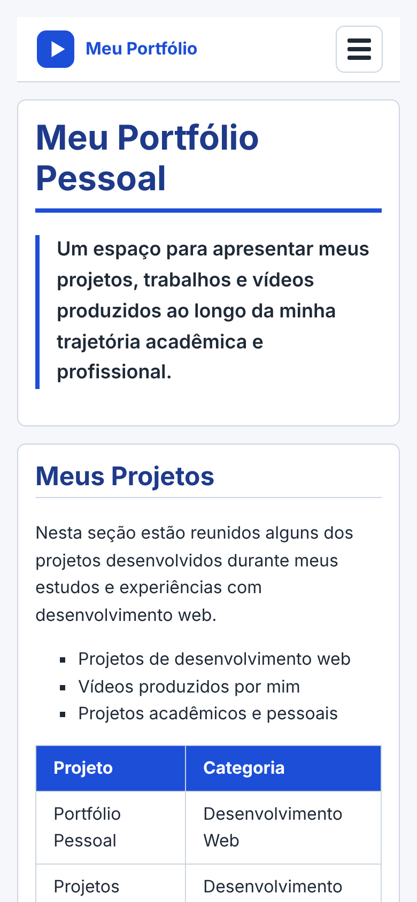
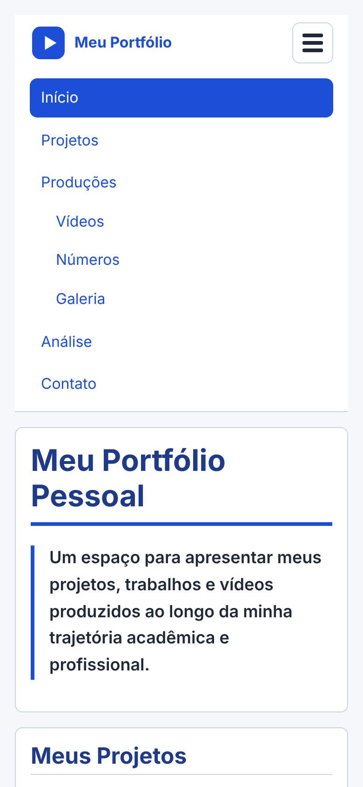
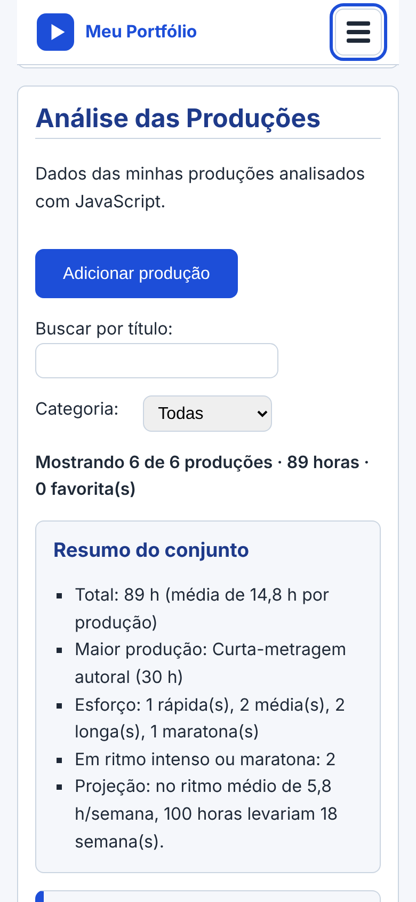

# Portfólio Pessoal

Site de portfólio pessoal para apresentar meus trabalhos e produções: vídeos, projetos web, trabalhos acadêmicos e experiências criativas.
O público são pessoas interessadas em conhecer meu trabalho, como colegas, professores e possíveis parceiros.
O objetivo é reunir tudo em um único lugar, de forma organizada, acessível e profissional.

## Tecnologias utilizadas

- **HTML5**: estrutura semântica, formulário, vídeo, SVG e canvas
- **CSS3**: variáveis, Flexbox, Grid, navegação com dropdown e menu hambúrguer, layout responsivo
- **JavaScript puro**: lógica, funções, arrays, manipulação do DOM, eventos e `localStorage`
- **Git e GitHub**: branches, Pull Requests e commits no padrão Conventional Commits

Nenhuma biblioteca ou framework foi usado.

## Capturas de tela

### Desktop





### Celular

| Início | Menu aberto | Análise das Produções |
|---|---|---|
|  |  |  |

## Estrutura de pastas

```
projeto-integrador-frontend-davidwilliam/
├── index.html
├── README.md
├── .gitignore
├── css/
│   ├── reset.css
│   └── style.css
├── js/
│   └── script.js
└── assets/
    ├── images/        (logotipo, poster do vídeo e capturas de tela)
    ├── video/         (vídeo em WebM e MP4)
    └── captions/      (legendas .vtt)
```

## Como executar

1. Clone o repositório: `git clone https://github.com/dwtomazz/projeto-integrador-frontend-davidwilliam`
2. Abra o `index.html` no navegador.
3. Recomendado: use a extensão **Live Server** do VS Code. Com um servidor local, as legendas do vídeo também carregam.

## Mapa dos requisitos

### 2.1 Repositório e organização

| Requisito | Onde foi atendido |
|---|---|
| Repositório público com o nome correto | GitHub: `projeto-integrador-frontend-davidwilliam` |
| Estrutura de pastas em minúsculas | Seção "Estrutura de pastas" deste README |
| Caminhos relativos e sem 404 | `index.html`: todos os `href` e `src` de CSS, JS, imagem, vídeo e legendas são relativos |
| Conventional Commits, branches e PRs | Abas **Commits** e **Pull requests** do repositório |
| Versão final na `main` | Branch `main` |
| README completo | Este arquivo |

### 2.2 HTML

| Requisito | Onde foi atendido |
|---|---|
| Estrutura HTML5 válida | `index.html`, `<head>`: DOCTYPE, `html lang="pt-BR"`, `meta charset`, `viewport`, `title` |
| `<h1>`, parágrafo, lista, tabela, link externo e imagem | `index.html`: `#inicio` (h1 e parágrafo), `#projetos` (lista e tabela), `#producoes` (link com `target="_blank"` e `rel="noopener noreferrer"`, imagem com `alt`) |
| Semântica | `index.html`: `header`, `nav`, um único `main`, seções com título e `footer` |
| Formulário | `index.html`, `#contato`: 5 campos, `label` com `for`/`id`, `fieldset` e `legend`, `required` e `pattern` |
| Mídia | `index.html`, `#producoes`: `<video>` com 2 `<source>`, `poster`, `<track>` e comentário sobre o `preload` |
| Gráfico em SVG e Canvas | SVG: logotipo na navbar (`index.html`, `.navbar__logo`). Canvas: `#grafico-producoes`, desenhado em `js/script.js` (`atualizarGrafico`), com `requestAnimationFrame` e `clearRect` |

### 2.3 CSS

| Requisito | Onde foi atendido |
|---|---|
| `reset.css` e `style.css` ligados | `index.html`, `<head>`; `css/reset.css` aplica `box-sizing: border-box` |
| 5 ou mais variáveis | `css/style.css`, `:root` |
| Classes, ID e combinador | Classes `.secao`, `.destaque` e `.botao`; ID `#titulo-principal`; combinador `.secao > h2` (comentado) |
| Box model explícito | `css/style.css`: `.botao` e `.secao` |
| Estados de link | `css/style.css`: `a:link`, `a:visited`, `a:hover` e `a:active`, nessa ordem |
| Tabela e lista | `css/style.css`: `table`, `th`, `td`, `ul` |
| `font-size` em rem | `css/style.css`: justificativa no comentário do `html` |
| Navbar | `css/style.css`, bloco "Aula 8": Flexbox, `.ativo`, dropdown por `:hover`, `position: sticky` e botão hambúrguer, que abre e fecha em `js/script.js` (`iniciarMenuHamburguer`) |
| Grid com pseudo-classes | `css/style.css`: `.galeria` (`auto-fit` e `minmax`), `.card:first-child`, `.card:nth-child(even)`, hover com `transform` |
| Responsivo | `@media (max-width: 48rem)` em `css/style.css` e grade sem media query |

### 2.4 JavaScript (`js/script.js`)

| Requisito | Onde foi atendido |
|---|---|
| Lista de 5 ou mais itens | Seção 1: array `producoes` (6 objetos) |
| Lógica (Aula 9) | Seção 2: `classificarEsforco` (`if/else if/else`), `indicarDestino` (`switch`), `resumirProducoes` (`for...of` com acumulador) e `projetarSemanas` (`while`). Comentário de planejamento no topo do arquivo |
| Funções e escopo (Aula 10) | Seção 3: `calcularHorasPorSemana` (processa) e `classificarRitmo` (classifica). `const`/`let`, `Number()` em `tratarEnvioFormulario`, escopo local em `resumirProducoes` |
| Arrays e DOM (Aula 11) | `map`: `analisarProducoes`; `filter`: `filtrarIntensas`; `reduce`: `calcularResumo`. Elementos criados em `criarItemLista` com `createElement` e `textContent`, e classes `ritmo-*` |
| Botão com estado | `#btn-novo` com `aria-expanded` e botão "Favorita" com `aria-pressed` (`tratarCliqueBotaoNovo`, `tratarCliqueLista`) |
| Delegação de eventos | `tratarCliqueLista`, um único ouvinte em `#lista` |
| Busca e filtro | `#busca` (`input`) e `#filtro-categoria` (`change`), ambos chamam `desenhar` |
| Resumo atualizado | `#resumo` com `aria-live="polite"` (`escreverResumo`) e painel `#resumo-logica` (`escreverPainelLogica`) |
| Sem `innerHTML` com texto digitado | O texto entra por `textContent` em `criarItemLista` |
| Script no fim do `<body>` com `defer` | `index.html`: um único `<script src="js/script.js" defer>` |
| Console sem erros | A página abre e funciona sem mensagens de erro |

## Autor

- **Nome:** David William Tomaz Gomes
- **RGM:** 47628791
- **Curso:** Engenharia de Software